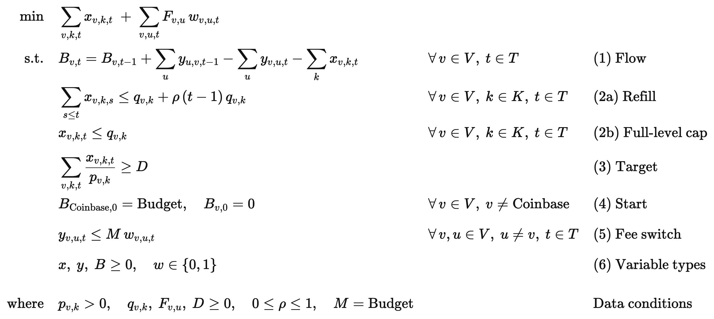

# The model (refill version)

Full paper: [PDF](<Optimal Cross-Venue Execution of Digital Assets (Refill Model).pdf>) · [Word](<Optimal Cross-Venue Execution of Digital Assets (Refill Model).docx>)

## In plain words

**Setting.** Buy D BTC across 4 exchanges (Coinbase, Kraken, Gemini, Bitstamp) over 10 one-hour rounds,
9 am to 7 pm Eastern. The whole budget starts at Coinbase. Prices and amounts come from one 9 am order book
snapshot per exchange, split into 10 price levels (each 0.1% wide).

**Sets.** V = exchanges, K = price levels 1 to 10 (1 is cheapest), T = rounds 1 to 10.

**Decision variables**
- x(v,k,t) = dollars spent at exchange v, price level k, round t
- y(v,u,t) = dollars sent from exchange v to exchange u in round t
- B(v,t) = cash left at exchange v at the end of round t
- w(v,u,t) = 1 if any money is sent from v to u in round t, otherwise 0 (binary)

**Data**
- p(v,k) = price per BTC at that level, trading fee included (9 am)
- q(v,k) = dollars of BTC for sale at that level (9 am)
- F(v,u) = flat fee for one transfer, ρ = refill rate (share of a level that comes back each hour),
  Budget = total cash, D = BTC target, M = Budget

**Objective.** Minimize dollars spent on BTC plus transfer fees.

| # | Constraint | What it means |
| --- | --- | --- |
| (1) | Flow | Cash at the end of a round = cash at the start + transfers that arrived (sent last round) − transfers sent − money spent. Like a bank statement. |
| (2a) | Refill | Total bought at a level so far can't exceed the 9 am amount plus ρ × that amount for each hour that has passed. A level you empty only partly comes back. |
| (2b) | Full-level cap | You can never buy more than one full level in a single round. |
| (3) | Target | BTC bought (dollars ÷ price, added up everywhere) must reach D. |
| (4) | Start | All cash at Coinbase, $0 at the other three. |
| (5) | Fee switch | If any money is sent (y > 0), then w = 1, so the fee is charged. |
| (6) | Types | x, y, B ≥ 0 and w is 0 or 1, which makes it a mixed-integer program. |

**Size:** 680 variables, 965 constraints (the notebook reports 961 because it writes the 4 starting-cash
values directly instead of as constraints).

**Baseline:** the same model with transfers turned off (buy everything at Coinbase). Savings = baseline cost − model cost.
